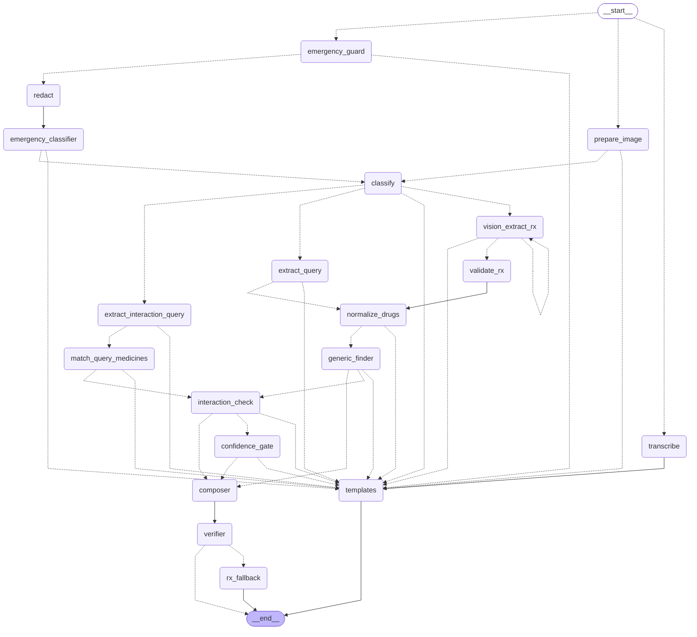

# Dawai Saathi 💊

**WhatsApp AI health assistant for Indian families — in Hindi and English.**

Send a photo of a prescription or lab report on WhatsApp and Dawai Saathi will:

- explain the prescription in simple language (dose, timing, duration),
- suggest cheaper generic / Jan Aushadhi alternatives with the same salt,
- explain lab report values against reference ranges,
- send dose reminders and alert a family member if doses are missed,
- flag known interactions between your medicines,
- understand Hindi/English voice notes.

> ⚠️ Dawai Saathi does not diagnose or prescribe. It explains what is written and always asks users to confirm with their doctor or pharmacist. In an emergency it directs users to call 112 / 108.

---

## Architecture

```
WhatsApp ──► Meta Cloud API ──► Gateway (NestJS + BullMQ) ──► AI Service (FastAPI + LangGraph)
                                     │                               │
                                PostgreSQL · Redis · S3        LLM/Vision · Pinecone · Langfuse
```

- **Gateway** — webhook, users & consent, messaging, reminders, caregiver alerts, queues.
- **AI Service** — stateless LangGraph pipeline: emergency guard → redaction → intent → extraction → drug matching / generic finder / interaction check / lab comparison → verifier → composer.

Full design, data model, safety rules and module plan: see [`CLAUDE.md`](./CLAUDE.md).

## Tech stack

NestJS · TypeScript · BullMQ · Redis · PostgreSQL (Prisma, pg_trgm) · Python · FastAPI · LangGraph · Claude / GPT-4o vision · Whisper · Pinecone · Presidio · Langfuse · OpenTelemetry · Docker · AWS (ECS Fargate, RDS, ElastiCache, S3) · Terraform · GitHub Actions

## Repository layout

```
apps/gateway        NestJS API, webhook, workers
apps/ai-service     FastAPI + LangGraph pipeline
apps/web            Next.js landing page, web demo playground and admin dashboard
packages/contracts  Shared API contracts
data/               Medicine, interaction & lab-range datasets + ingestion scripts
evals/              Evaluation datasets, runner and reports
infra/              Terraform & Docker
docs/               ADRs, WhatsApp templates, runbooks
```

## Getting started

### Prerequisites
- Node.js 20+ (`.nvmrc`), pnpm 9 (`npm i -g pnpm@9` or `corepack enable`)
- Python 3.12 (`.python-version`), [uv](https://github.com/astral-sh/uv)
- GNU Make (on Windows, run `make` from Git Bash)
- Docker Desktop (Compose v2) — runs the local Postgres, Redis and MinIO
- Later modules: a Meta developer app with WhatsApp Cloud API (test number is fine) and API keys for your LLM provider(s)

### Setup (works today — M0 + M1)
```bash
git clone <repo-url> dawai-saathi && cd dawai-saathi
cp .env.example .env            # local-only defaults work as-is (see "Ports" below)
make install                    # pnpm install + uv sync (also installs git hooks, generates the Prisma client)
make up                         # postgres + redis + minio (+ private bucket with retention rule), waits until healthy
make migrate                    # apply Prisma migrations (creates all tables, pg_trgm index, constraints)
make dev                        # gateway :3000, ai-service :8000

curl localhost:3000/health/live   # {"status":"ok"}                       (process is up)
curl localhost:3000/health/ready  # {"status":"ok","checks":{"db":"ok","redis":"ok","s3":"ok"}}
curl localhost:8000/health/ready  # {"status":"ok","checks":{"db":"ok"}}
# /health/ready returns HTTP 503 with "fail" for the broken dependency when something is down.
```

Checks and tests:
```bash
make lint                       # Prettier, ESLint, ruff
make typecheck                  # tsc (gateway), mypy --strict (ai-service)
make test                       # unit + e2e (no Docker needed)
make test-integration           # real Postgres/Redis/MinIO on separate ports (5543/6479/9100); cleans up after itself
```

**Local URLs:** MinIO console <http://localhost:9001> (login `dawai-minio` / `dawai-minio-secret`), Prisma Studio via `make db-studio`, Langfuse <http://localhost:3002> after `make up-obs`.

**Ports.** Defaults are 5432 (Postgres), 6379 (Redis), 9000/9001 (MinIO). If one is taken on your machine (a Windows-installed Postgres often owns 5432), change `POSTGRES_PORT` / `REDIS_PORT` / `MINIO_API_PORT` in `.env` and keep `DATABASE_URL`, `AI_DATABASE_URL` and `REDIS_URL` in sync.

**Database access.** The gateway connects as `dawai` (read/write). The AI service connects as `dawai_ai_ro`, a role that can only `SELECT` from `drugs`, `interactions` and `lab_tests` (set `AI_DATABASE_URL`; it falls back to `DATABASE_URL`). To start from scratch: `make db-reset`.

Other targets: `make format`, `make build`, `make docker-build`, `make down`, `make logs`, `make migrate-dev name=<name>`, `make clean`, `make help`.

Coming later: `make eval` (M14). For now it only prints which module will implement it.

### Test the webhook locally

**Without Meta (recommended first).** `make webhook` sends a sample payload, signed with your `WA_APP_SECRET` exactly like Meta signs it. Start `make up`, `make migrate`, `make dev` first.

```bash
make webhook FIXTURE=text                 # -> HTTP 200 {"status":"received"}; a row in `messages`, a job logged by the worker
make webhook FIXTURE=text                 # again: same message id -> no new row, no new job
make webhook FIXTURE=text FRESH=1         # new sender + new message ids every time
make webhook FIXTURE=text BAD_SIGNATURE=1 # -> HTTP 401
make webhook FIXTURE=batch WEBHOOK_URL=http://localhost:3010/webhook/whatsapp   # if :3000 is taken
```

Fixtures (`apps/gateway/test/fixtures/whatsapp/`, fake numbers only): `text`, `image`, `document`, `audio`, `button`, `button-legacy`, `unsupported`, `location`, `status`, `batch`, `foreign`, and for the conversation flow `help`, `delete`, `emergency`, `lang-hi`, `lang-en`, `consent-yes`, `consent-no`, `delete-confirm`, `delete-cancel`.

To act as ONE user through onboarding, consent, commands and DELETE without Meta, keep the sender and change only the message ids:
```bash
export PHONE=919888800001 NEW_IDS=1
make webhook FIXTURE=text            # first message -> language buttons
make webhook FIXTURE=lang-en         # tap "English"  -> consent message
make webhook FIXTURE=consent-yes     # tap "I agree"  -> welcome
make webhook FIXTURE=help
make webhook FIXTURE=delete          # -> "Delete everything?" buttons
make webhook FIXTURE=delete-confirm  # -> user erased, final message
```
(Replies are sent to the Graph API, so with a fake `WA_ACCESS_TOKEN` you will see the sends fail in the gateway log; use a real Meta test number, or point `WA_API_BASE_URL` at a mock.)

Check the handshake yourself (use your `WA_VERIFY_TOKEN`):
```bash
curl "localhost:3000/webhook/whatsapp?hub.mode=subscribe&hub.verify_token=local-dev-verify-token&hub.challenge=123"   # -> 123
```

**Real WhatsApp round trip:** see the next section (needs a Meta test number).

### Connect a real Meta test number (echo bot)

With M3 the bot can talk back. A temporary **dev-only echo bot** proves the whole loop (webhook → queue → worker → WhatsApp reply) with a real number. It answers anyone who writes to the number and **skips consent**, so it is off by default and the app refuses to start with it on in production.

1. **Create the Meta app.** [developers.facebook.com](https://developers.facebook.com/apps) → Create app → type *Business* → add the **WhatsApp** product. WhatsApp → *API Setup* shows a free **test number** and its **Phone number ID**.
2. **Add yourself as a recipient.** On the same page, under *To*, add your own WhatsApp number and confirm the code Meta sends. A test number can only message numbers that are on this list.
3. **Get a token.** *API Setup* shows a **temporary access token** (valid 24 hours: fine for a first test, copy a fresh one each day). For anything longer-lived create a **System User** in Business Settings → Users → System users, give it the app with *Full control*, and generate a token with the `whatsapp_business_messaging` and `whatsapp_business_management` permissions (it does not expire).
4. **Fill `.env`** (never commit it):
   ```
   WA_ACCESS_TOKEN=<the token>
   WA_PHONE_NUMBER_ID=<Phone number ID from API Setup>
   WA_APP_SECRET=<App settings → Basic → App secret>
   WA_VERIFY_TOKEN=<any string you invent, e.g. dawai-verify-2026>
   DEV_ECHO_BOT=true
   ```
5. **Run the stack:** `make up && make migrate && make dev`. If another process owns port 3000 use `PORT=3010 make dev` or run the gateway yourself, and tunnel that port.
6. **Expose it:** `ngrok http 3000` (or `cloudflared tunnel --url http://localhost:3000`). Copy the `https://…` URL.
7. **Register the webhook.** WhatsApp → *Configuration* → Webhook → Edit: callback URL `https://<tunnel>/webhook/whatsapp`, verify token = your `WA_VERIFY_TOKEN`. Meta calls the GET handshake immediately: *Verify and save* succeeds only if the gateway is running and the token matches. Then **Manage → subscribe to `messages`**.
8. **Try it.** From your phone send "hello" to the test number. You should get `[dev] आपने लिखा: hello` within a couple of seconds (blue ticks first). Send a photo: you get `[dev] आपका image मिल गया (N KB) और सेव हो गया।` and the file appears in the MinIO console (<http://localhost:9001>, bucket `dawai-media`, `media/<user-id>/<yyyy>/<mm>/<message-id>.jpg`).

If nothing happens: the gateway log shows each Graph API call (`whatsapp api call`, with status and Meta error code, never the token or numbers). Common causes: `401 / code 190` = expired token; `403` on the webhook = wrong verify token; signature `401` = wrong `WA_APP_SECRET`; no reply but `131030` = your number is not on the recipient list; `131047` = more than 24 h since you last wrote (send "hello" again).

**Outside the 24 h window** only approved *template* messages can be sent; their texts are in [`docs/whatsapp-templates.md`](docs/whatsapp-templates.md).

**Without Meta at all:** the integration tests mock the Graph API (`make test-integration`), and `make webhook` simulates inbound messages.

## AI service (M5)

The gateway sends every ordinary message of a consented user to the AI service (`POST /v1/process`, header `X-Service-Token`) and forwards the reply. Text is classified and answered with a fixed template (M5, M6); photos and PDFs of prescriptions are read since M7 (next section).

**Fake mode (default, no API keys, used by tests and CI):** `LLM_MODE=fake`. Start with `make dev`; send "help" from WhatsApp (or call the endpoint with curl). `LLM_MODE=fake` is refused when `NODE_ENV=production`.

**Real mode:** set `LLM_MODE=real`, `LLM_PRIMARY` / `LLM_FALLBACK` (`anthropic` | `openai`), the matching `ANTHROPIC_API_KEY` / `OPENAI_API_KEY`, and the model ids for both providers: `VISION_MODEL`, `TEXT_MODEL`, `CHEAP_MODEL` and `FALLBACK_VISION_MODEL`, `FALLBACK_TEXT_MODEL`, `FALLBACK_CHEAP_MODEL`. Model ids are never hard-coded. Fill in the real prices in `apps/ai-service/app/llm/pricing.yaml` (the shipped values are placeholders). Optional tracing: `LANGFUSE_PUBLIC_KEY`, `LANGFUSE_SECRET_KEY`, `LANGFUSE_HOST`. `/health/ready` reports `llm_config` and returns 503 when the configuration is invalid.

**Contract:** the OpenAPI file `packages/contracts/openapi/ai-service.json` and the gateway types in `apps/gateway/src/ai-client/generated/` are generated from the Pydantic schemas. After changing a schema run `make contracts` and commit the result; CI fails on any drift.

## Safety layer (M6)

Three guards run before any medical work (CLAUDE.md §2):

1. **Emergency guard.** The gateway keeps a keyword pre-check (works even when the AI service is down). The AI service adds the same rules with fuzzy matching, plus a cheap-model classifier for messages the rules miss. A match answers at once with 112 / 108 (self-harm adds Tele-MANAS 14416), makes no further model call, and the gateway sends it at top queue priority and writes an `emergency_detected` audit row (category only). If the classifier is down the rules still decide.
2. **PHI redaction.** Presidio + spaCy (`en_core_web_sm`) with Indian recognisers (mobile, Aadhaar-like, PAN, ABHA, PIN, hospital ids, names after Mr / Dr / "mera naam"). Applied to the text sent to models, to log fields named `text|body|prompt|output` and to Langfuse. Doses, schedules and lab values are never redacted. `REDACTION_ENABLED=false` is refused in production.
3. **Scope guard.** Only medicines, prescriptions and lab reports. Everything else (cricket, coding, diet advice ...) gets a fixed polite reply; the model never writes it.

The emergency phrases live in ONE file, `packages/contracts/safety/emergency-keywords.json`. After editing it run `make safety-data` (or `make contracts`); a test in each app fails if its copy is stale. `make eval-emergency` runs the emergency eval set (`evals/datasets/emergency/`), writes a report to `evals/reports/` and fails when recall drops below 100%; `make eval-emergency MODE=real` does the manual run with your real model keys.

## LangGraph pipeline (M9)

The AI service runs a LangGraph state machine (`apps/ai-service/app/graph/`). `PIPELINE=graph` is the default; `PIPELINE=minimal` is the pre-graph rollback switch. `make graph` regenerates the diagram below (`docs/architecture/graph.mmd`; `GRAPH_PNG=1` also renders a PNG through mermaid.ink, which receives node names only). Per-node limits: `NODE_TIMEOUT_*_S`, `GRAPH_RECURSION_LIMIT`. `DEMO_SERVICE_TOKEN` (optional, at least 16 characters, different from `SERVICE_TOKEN`) lets the web demo send `options.include_trace` to `/v1/process` and receive a `debug_trace`; no other caller gets it. Regression check against the minimal pipeline: `uv run --project apps/ai-service python evals/run_pipeline_comparison.py`.



## Prescriptions (M7): try it

Send a photo (or PDF) of a prescription to the bot after you have finished onboarding. The reply lists every medicine with dose, timing, food relation and duration, flags anything it could not read clearly (and asks you to confirm it with your pharmacist), and shows three buttons: **Set reminders** ("coming soon": M10) and **Generic medicines** (M8) and **Something is wrong** (marks the document for review and switches its medicines off). `MEDS` lists the saved medicines.

```
photo / PDF ─► pre-process (EXIF stripped, resized, blur/dark check) ─► classify (prescription? lab report? strip?)
            ─► vision extract (strict JSON, per-field confidence) ─► validate (written codes beat the model) ─► confidence gate
            ─► compose (LLM phrases ONE line per readable medicine) ─► grounding check (else template) ─► reply + save
```

- **Locally without API keys:** `make dev` (fake LLM). Any photo returns a fixed sample prescription (two clear medicines and one unreadable line), enough to see the reply, the buttons and the saved rows. The fake never looks at pixels.
- **With a real model:** set `LLM_MODE=real` and the model ids (see "AI service"). `VISION_MODEL` reads the prescription, `TEXT_MODEL` phrases the lines, and **`CHEAP_MODEL` must accept images** (it classifies the photo). `EXTRACTION_MIN_CONFIDENCE` (default 0.75) is the "say so, do not guess" threshold; `VISION_MAX_PX` and `IMAGE_MIN_SHARPNESS` tune the image check.
- **Containerised AI service:** presigned S3 URLs are bound to the hostname they were signed for. If the AI service reaches S3 under another name than the gateway (for example `http://minio:9000`), set `S3_AI_ENDPOINT` for the gateway and add that host to `ALLOWED_MEDIA_HOSTS` of the AI service.
- **Reminder clock times:** a written "morning / afternoon / evening / night" is saved as `MED_TIME_MORNING` (08:00), `MED_TIME_AFTERNOON` (14:00), `MED_TIME_EVENING` (18:00), `MED_TIME_NIGHT` (21:00), Asia/Kolkata.
- **Prescription eval:** `make eval-rx` generates 24 synthetic prescription images (`evals/datasets/prescriptions/`, see its README), replays them through the pipeline with a fake model and writes `evals/reports/<date>-rx_extract_v1-rx-fake.md`. The fake modes check the safety rules around the model (flag recall, no PHI leakage, no invented medicine, grounded replies), not model accuracy. `make eval-rx MODE=fake-noisy` injects model mistakes; **`make eval-rx MODE=real`** runs your real provider on the images (needs keys, costs money) and is the only mode that measures reading quality.
- Migration `20261108100000_rx_persistence` (run `make migrate`) makes `medications.frequency_per_day` nullable (as-needed medicines), adds `medications.as_needed` and a unique `documents.message_id`.

## Medicine catalog and generic finder (M8)

For every medicine read from a prescription the AI service looks it up in the catalog (`drugs`), and
suggests a cheaper generic only when the salt, strength, form AND release type (plain / SR / ER ...)
are exactly the same. Details and the open gaps: [`data/SOURCES.md`](./data/SOURCES.md).

**Seed the catalog (once, and again whenever the price list changes):**

```bash
make migrate                      # applies the M8 migration (new drugs columns, salt_aliases, match fields)
make seed                         # 73 curated brands (no prices) + Jan Aushadhi if data/raw/pmbjp/*.csv exists
make seed FIXTURE=1               # ... plus FICTIONAL generics and prices, for a local demo only
make seed PMBJP_DATE=2026-01-31   # needed when Jan Aushadhi CSV files are present (the list's own date)
make seed BRANDS_CSV=data/raw/brands.csv   # a brand list you supply (local only, never committed)
make embed                        # vector fallback: uploads to Pinecone if VECTOR_BACKEND=pinecone, else a check
```

`make seed` is idempotent and writes an ingestion report to `data/reports/` (rows read / accepted /
rejected by reason). The Jan Aushadhi list must be exported to CSV with the columns `Drug Code,
Generic Name, Unit Size, MRP` first; strength and form are parsed from the name, and a row that cannot
be parsed safely is rejected, never guessed. `FIXTURE=1` is refused when `NODE_ENV=production`.

**Try it:** with the fixture seeded, send a prescription photo (the fake LLM returns Dolo 650, Pantop 40
and one unreadable line): the reply shows "A cheaper option with the same salt is available" under
Dolo 650, and the **Generic medicines** button sends the details (name, "Jan Aushadhi" tag, approximate
price and saving, price date, and "Same salt, same strength. Please ask your doctor or pharmacist before
switching"). Typing `Dolo 650 ka generic batao` does the same for one medicine.

**What is never suggested:** narrow-therapeutic-index drugs (levothyroxine, warfarin, phenytoin ...),
insulins and biologics, every modified-release product, inhalers and forms we could not classify, a
medicine whose written strength or form contradicts the catalog product, and anything unreadable. The
list lives in `apps/ai-service/app/safety/no_substitute.yaml` and **must be reviewed by a pharmacist
before launch**. A saving is only stated when both the brand price and the alternative price are known.

**Evals (offline, no keys):** `make eval-matcher` runs 279 synthetic cases and fails on any wrong-strength,
wrong-form/release, wrong-salt or forbidden suggestion (all four must be 0); `make eval-rx` now also checks
suggestions end to end on the synthetic prescriptions. Both run in CI.

Settings: `DRUG_TRGM_MIN`, `DRUG_MATCH_MIN`, `DRUG_VECTOR_MIN`, `MIN_SAVINGS_PCT`, `VECTOR_BACKEND`,
`PINECONE_INDEX_HOST`, `EMBEDDING_*` (see `.env.example`). The Pinecone and embedding-API code is tested
against mocked HTTP only.

## Interaction checks (M11)

When you send a prescription, the AI service checks the new medicines against each other AND against
every medicine you already have stored from **earlier prescriptions and other doctors**, and warns about:

* **the same ingredient twice** (two brands of paracetamol from two doctors): a real overdose risk. It
  never gives a dose; it says "both contain paracetamol, ask your doctor or pharmacist";
* **known interactions** from the `interactions` table, worded by severity (major: "talk to your doctor
  today", moderate: "some caution is needed", minor: only in the details view).

The bot never says "stop this medicine". It says what is known and sends you to a doctor or pharmacist.
**No row, no claim:** a language model never states an interaction. "Nothing found" is worded as "not in
my list, which does not mean there is none", and a medicine that could not be looked up is named, never
called safe. Source, licence reasoning and the partial coverage: [`data/SOURCES.md`](./data/SOURCES.md).

```bash
make migrate                # m11_interactions: new interactions columns + medication_warnings
make seed                   # also loads data/seed/interactions_core.csv (idempotent)
make eval-interactions      # 135 offline cases; every safety gate must be 0
```

**On WhatsApp**

| What | Result |
|---|---|
| Send a prescription | Reply with the usual 3 buttons + the interaction notes; if there are any, a short follow-up message with the **Interaction details** button (`ix:details:<document id>`) |
| `Dolo aur Combiflam saath le sakte hain?` | A typed question: names are matched in the catalog, then checked; nothing is saved |
| `CHECK` / `jaanch karo` | Re-checks all your active medicines and keeps the stored warnings up to date |
| `MEDS` | A warning sign marks medicines that are part of an active warning |
| **Something is wrong** on a prescription | Its medicines are switched off and their warnings are resolved |

**Try it:** send two prescriptions that both contain paracetamol (with the fake LLM the second reply shows
the duplicate-ingredient warning), then type `Dolo aur Combiflam saath le sakte hain?` and `CHECK`.
Hindi wording is unreviewed: see `data/review/` (CSV files for a pharmacist to approve; put approved
lines in `data/review/interactions_hi_reviewed.csv`, columns `salt_a,salt_b,management_hi`).

Endpoints (internal, service token): `POST /v1/interaction-check` (CHECK) and `POST /v1/interaction-details`
(the details button). Neither calls a model.

## Conversation flow (M4)

Every first-time number goes through the same short path, and **nothing is processed before consent**:

```
first message ──► choose language (हिन्दी / English) ──► consent message ──► "I agree" ──► active
                                                              │ "Not now": nothing is read or saved
```
- **Before consent** only metadata is stored (no message text) and media is never downloaded; a photo just brings the consent reminder back.
- **Emergency words** (chest pain, "saans nahi", suicide, ...) are answered with 112 / 108 (and Tele-MANAS 14416 for self-harm) at any step, even before consent.
- **Commands** (whole-message match, any case): `HELP`, `LANGUAGE`, `MEDS`, `STOP REMINDERS` / `START REMINDERS`, `DELETE`. `HELP` and `DELETE` work at every step.
- **`DELETE`** asks "Delete everything?" (valid for 5 minutes). On "Yes" a background job removes the photos from storage, the user's queued jobs and **all database rows**, leaves one anonymous `user_deleted` audit record, and sends a final confirmation. The same number writing again starts fresh.
- Set `PRIVACY_POLICY_URL` for the link shown in the consent message (the real page arrives with M16).

## Reminders and caregiver (M10)

After a prescription is read, tap **Set reminders** under the reply:

```
[Set reminders] -> summary built from the saved medicines: Dolo 650 - 08:00, 21:00 (5 days)
                   [Yes, set them] [Change times] [Cancel]
[Change times]  -> "subah 7, raat 10" / "7am 10pm" / "07:00 22:00" (a fixed parser, no LLM) -> summary again
[Yes, set them] -> reminders at each time; ONE message per time even if 3 medicines are due
every reminder: [Le li] [Baad me] [Skip]   (text "le li", "baad me", "skip" works for 2 hours too)
```

- Medicines that are as-needed (SOS), not read clearly, or without a daily frequency get **no** reminder, and the summary says why.
- A prescription without a written duration is scheduled for `REMINDER_OPEN_ENDED_DAYS` (30) and the bot asks the day before it ends whether to continue.
- **Snooze** adds `SNOOZE_MINUTES` (30), at most twice per reminder, and never into quiet hours (22:30-06:30).
- No answer for `REMINDER_ACK_TIMEOUT_MIN` (60) = **missed**. `Skip` is *skipped*, not missed. A late "Le li" within 6 hours still counts.
- Inside the 24-hour WhatsApp window the reminder is an interactive message, outside it the approved `dose_reminder` template (texts in `docs/whatsapp-templates.md`).
- `REMINDERS` lists the reminders with Pause / Resume buttons. `STOP REMINDERS` / `START REMINDERS` pause / resume everything. **Something is wrong** on a prescription cancels its reminders.

**Caregiver (family contact):** `CAREGIVER +91XXXXXXXXXX` -> "what does this person call you?" (for example *Papa*) -> the caregiver gets an invite template and must reply **YES** within 48 hours. After `CAREGIVER_ALERT_AFTER_MISSES` (2) missed times in a row they get a short alert with the name and the time, **never a medicine name**. At most one alert per 6 hours and three per day. The caregiver can send `STOP ALERTS`, the user `CAREGIVER REMOVE`. Maximum 2 caregivers. `DELETE` removes everything.

Run the planner by hand: the `reminders` worker registers a repeatable job every 15 minutes; `WORKERS_ENABLED=true` is enough.

### Try it on a real number (dev helper)

Set `REMINDER_TEST_OFFSET_MIN=3` in `.env` (refused when `NODE_ENV=production`) and restart. Then **Set reminders** -> **Yes, set them** schedules the first reminder 3 minutes from now (the next ones 2 minutes apart) instead of 08:00 / 21:00:

1. Tap **Le li** on the first reminder, **Baad me** on the second (it comes back after `SNOOZE_MINUTES`).
2. Add a second number: `CAREGIVER +91...` -> label -> reply **YES** from that number.
3. Ignore two reminders in a row: after `REMINDER_ACK_TIMEOUT_MIN` minutes each is missed and the second miss sends the alert. For a faster test also set `REMINDER_ACK_TIMEOUT_MIN=5`.
4. Remove the variable again afterwards.

Tests: `make test` (unit, fake clock) and `make test-integration` (`reminders.int-spec.ts` walks a 5-day prescription through taken / snooze / skipped / missed / late / caregiver alert on a fake Asia/Kolkata clock; `reminders-flow.int-spec.ts` goes webhook -> router -> workers -> mocked Graph API).

## Common commands

| Command | Description |
|---------|-------------|
| `make up` / `make down` | Start / stop local infrastructure (`make up-obs` adds Langfuse) |
| `make dev` | Run gateway and AI service with hot reload |
| `make test` | Unit + e2e tests (both apps, no Docker needed) |
| `make test-integration` | Integration tests against real Postgres, Redis, MinIO |
| `make webhook FIXTURE=text` | Send a signed sample WhatsApp webhook to the local gateway |
| `make lint` | ESLint, Prettier, ruff, mypy |
| `make migrate` | Apply database migrations (`make migrate-dev name=…` creates one) |
| `make db-reset` | Wipe local volumes, restart infra, re-migrate (asks first) |
| `make safety-data` | Copy the shared emergency keywords into both apps |
| `make eval-emergency` | Emergency-detection eval (rules, then rules + classifier) |
| `make seed` / `make embed` | Load the medicine catalog / embed it for the vector fallback (see M8 section) |
| `make eval-matcher` | Drug matching + generic finder eval (all safety gates must be zero) |
| `make eval-interactions` | Interaction checker eval (135 cases, every safety gate must be zero) |
| `make eval-rx` | Prescription eval on synthetic images (`MODE=fake-noisy`, or `MODE=real` with your keys) |
| `make seed` | Load catalog datasets |
| `make eval` | Run evaluation suite → `evals/reports/` |

## User commands (on WhatsApp)

`HELP` · `MEDS` · `CHECK` (or `jaanch karo`) · `REMINDERS` · `STOP REMINDERS` / `START REMINDERS` · `CAREGIVER +91XXXXXXXXXX` / `CAREGIVER REMOVE` · `LANGUAGE` · `DELETE`

## Privacy

- Explicit consent before any processing.
- Phone numbers encrypted; logs and traces contain no personal data.
- Media auto-deleted after the retention period.
- `DELETE` permanently removes all of a user's data.
- Data hosted in AWS `ap-south-1` (Mumbai).

## Roadmap

See the module plan and progress tracker in [`CLAUDE.md` §14](./CLAUDE.md#14-module-plan--progress-tracker).

## Disclaimer

This project is for informational support only and is not a medical device. It does not replace advice from a qualified doctor or pharmacist.
