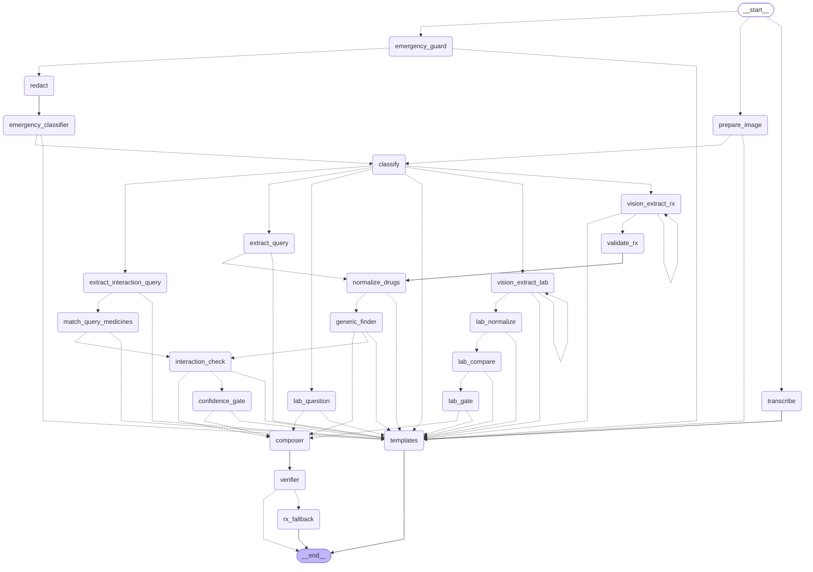

# M9 — LangGraph orchestration

## Is module me kya banaya
M7/M8 ka ad-hoc pipeline (`RxPipeline` + `MinimalPipeline`) ab ek **typed LangGraph state machine** hai (`apps/ai-service/app/graph/`). Koi naya user feature nahi: lab report, interactions aur voice ke liye sirf placeholder branch (static template). Har node ke liye timeout, Langfuse span, structured log aur metrics. `PIPELINE=minimal` purana pipeline wapas la deta hai (rollback switch).

## Kyun zaroori tha
Pehle flow if/else me bikhra tha: naya branch (lab, interaction) jodna risky, retry/timeout har jagah alag, aur "kaun sa step kitna time/paisa leta hai" dikhta nahi tha. Graph me routing, retry aur tracing ek jagah hain, aur web demo (M16) ko `debug_trace` mil sakta hai.

## Kaise kaam karta hai

- `route_input`: text → `emergency_guard`; image → `prepare_image` (emergency nodes tak image **kabhi** nahi pahunchti, test se pakka); audio → `transcribe` → templates.
- Text: `emergency_guard` (rules, RAW text) → `redact` → `emergency_classifier` → `classify`.
- Prescription image: `vision_extract_rx` → `validate_rx` → `normalize_drugs` → `generic_finder` → `confidence_gate` → `composer` → `verifier`.
- Typed generic query: `extract_query` → `normalize_drugs` → `generic_finder` → `composer` → `verifier`.
- Verifier fail → `rx_fallback` (deterministic j2 template). Koi bhi node `template_key` set kare to `templates` par jata hai.

**State** (`state.py`): Pydantic `GraphState`. Reducers: `warnings`, `errors`, `node_timings`, `cost_usd` = `operator.add` (list/sum append); `retries` = dict-merge. Node `state -> partial dict` return karta hai. Images state me `exclude=True` (serialise/trace me nahi jaati).

**Retry loop:** `vision_extract_rx` fail/schema-invalid → `after_extract` pure function dekhta hai `state.retries["vision_extract_rx"] < 1` → ek baar dobara, **strict prompt** `rx_extract_strict_v1` ke saath. Phir bhi fail → `needs_review`. Worst case 4 vision calls (2 providers × 2 attempts); real model par ye prompt abhi test nahi hua.

**Timeouts:** `@traced_node(name, timeout=class)` har node ko `min(node limit, deadline.remaining())` deta hai. Timeout par `on_timeout` fallback ya `NodeTimeoutError` (504 `NODE_TIMEOUT`). Poore graph par `GRAPH_RECURSION_LIMIT` (25).

## Important technical decisions
- **Checkpointer nahi:** service stateless hai (CLAUDE.md §4); state me PHI-adjacent data hota, usse DB/Redis me rakhna §2.6 ke khilaf. Retry ek hi request ke andar hota hai, resume ki zaroorat nahi.
- **Routing pure functions** (`routing.py`): bina LLM/IO ke unit-test.
- **Verifier ek jagah:** reply limits, disclaimer, ₹ main reply me nahi, LLM lines grounded, low-confidence flagged, aur generics ka defence-in-depth re-check (4 keys + no-substitute).
- **Tracing:** node span ke andar LLM generations nest. Vision calls ka raw OCR output trace se hata diya (PHI).
- **`debug_trace`** sirf demo client (`DEMO_SERVICE_TOKEN`, sirf `/v1/process`) ko aur sirf `options.include_trace` par; usme naam/numbers hi, text nahi.
- Gotcha: node wrapper par `functools.wraps` nahi, warna LangGraph `runtime` argument pass nahi karta.

## Production-ready points
- Emergency recall 100%, hard gates 0 (neeche table). 34 scenarios par minimal aur graph ka user-visible output, cost aur prompt versions bilkul same (parity test).
- Per-node timeout + deadline + recursion limit; node errors/fallback metrics (`observability/metrics.py`).
- Diagram drift test (`test_graph_diagram.py`): `make graph` commit karna padega.

## Regression evals (fake models, offline: behaviour same hai ye check karta hai, model quality nahi)
`uv run --project apps/ai-service python evals/run_pipeline_comparison.py` → `evals/reports/2026-11-08-graph-vs-minimal.md`: **PASS**.

| Set | Metric | minimal | graph |
|---|---|---|---|
| Emergency (152 msgs) | missed emergencies / recall / clear-negative FP | 0 / 100% / 0 | 0 / 100% / 0 |
| Prescriptions (24) | flag misses, PHI leaks, hallucinated, ungrounded, unsafe generics, errors | 0 | 0 |
| Prescriptions | medicine precision / recall | 1.000 / 0.952 | 1.000 / 0.952 |
| Prescriptions | done / needs_review / failed | 15 / 9 / 0 | 15 / 9 / 0 |
| Typed generic questions (284) | wrong strength, wrong form/release, wrong salt, forbidden suggestion | 0 | 0 |
| Typed generic questions | cases with a suggestion | 57 | 57 |

Is eval ne ek **M8 safety bug** pakda: "Dolo 650 syrup ka generic batao" me form word `brand_key` se hat jata tha aur tablet generic suggest ho jata tha (3 forbidden suggestions, dono pipelines me). Fix: `explicit_form()` (`catalog/normalise.py`) + `_form_conflict` (`tools/drug_matcher.py`), aur dataset me `form_in_name` ke 5 naye cases.

## Interview me kaise bolna hai
"Maine ad-hoc pipeline ko LangGraph state machine me badla: typed Pydantic state, reducers, conditional edges pure functions me. Har node par timeout, Langfuse span aur metrics hain. Extraction fail ho to ek bounded retry strict prompt ke saath, phir needs_review. Verifier deterministic hai, LLM par bharosa nahi. Checkpointer jaan-bujhkar nahi lagaya kyunki service stateless hai aur PHI persist nahi karna. Migration ke baad dono pipelines par same evals chalaye: koi metric kharab nahi, aur is process me ek real form-mismatch bug mila aur fix hua."

## Possible interview questions
1. **Graph kyun, simple function chain kyun nahi?** Branching, bounded retry, per-node timeout/tracing ek jagah; naye branch (lab, voice) sirf nodes + edges.
2. **Checkpointer kyun nahi?** Stateless service, PHI persist nahi, retry request ke andar; resume ka use-case nahi.
3. **Retry infinite loop se kaise bachta hai?** `state.retries` + `MAX_EXTRACTION_RETRIES=1` + recursion limit + deadline.
4. **Safety kaise guarantee?** Emergency node pehle, image us tak nahi pahunchti (structural test); verifier + generic re-check; hard gates CI me.
5. **Rollback?** `PIPELINE=minimal`, purana code intact.
6. **Kaun sa node sabse mehnga?** Structure se `vision_extract_rx` (vision model, retry par 2x). **Maine per-node cost measure nahi kiya**: eval fake models par chalta hai aur `pricing.yaml` ki prices placeholders hain. Real keys ke saath `make eval-rx MODE=real` ya demo ke `debug_trace` (cost per node) se naapna hoga.

## Files / folders
`apps/ai-service/app/graph/{state,routing,builder,traced,errors}.py`, `graph/nodes/*`, `app/pipeline/graph.py`, `app/observability/{metrics,tracing}.py`, `app/tools/{intent,rx_enrich,image_input}.py`, `app/prompts/files/rx_extract_strict_v1.md`, `scripts/export_graph.py`, `docs/architecture/graph.mmd`, `evals/run_pipeline_comparison.py`, `tests/test_graph_*.py`.
